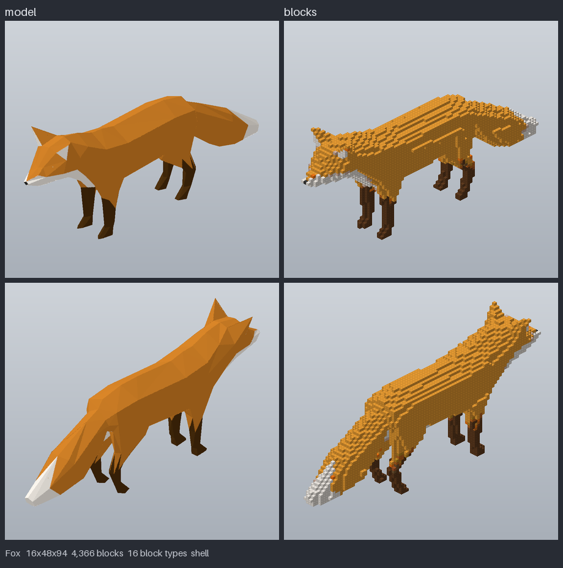
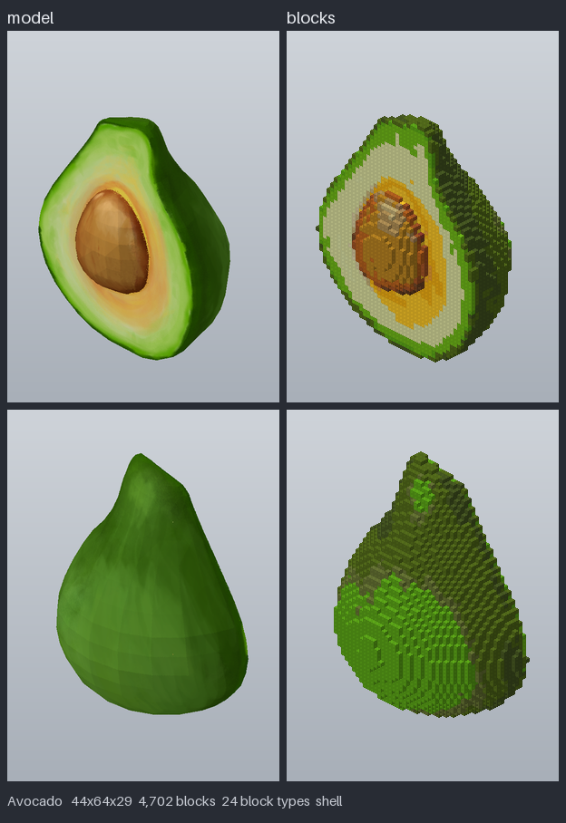
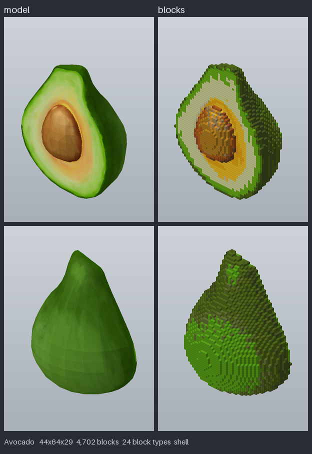
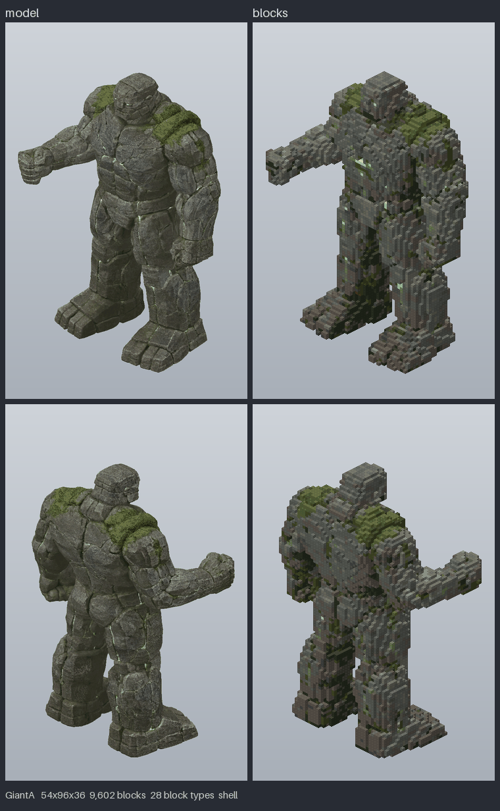

<p align="center">
  <picture>
    <source media="(prefers-color-scheme: dark)" srcset="docs/branding/model2mc-logo-dark.svg">
    
  </picture>
</p>

# model2mc

**Turn a 3D model into a Minecraft build.** Give it a GLB (or glTF, OBJ or STL) and a height in blocks, and it writes a
WorldEdit schematic, vanilla structure files, a plain voxel dump and a preview image of the model next to the result.

<p align="center">
  <a href="https://www.python.org/downloads/"></a>
  <a href="https://github.com/Stink-O/model2mc/actions/workflows/tests.yml"></a>
  <a href="https://github.com/horizon-rust/horizon"></a>
  
  <a href="#made-with-tripo"></a>
  <a href="https://github.com/Stink-O/model2mc/discussions"></a>
  <a href="LICENSE"></a>
</p>



It works with any textured model: a scan, something you modelled yourself, or a model from an AI text-to-3D or
image-to-3D generator. Those usually come out as a single mesh with one base-colour texture, which is what this tool
handles best.

I built it for [Horizon](https://github.com/horizon-rust/horizon), the Rust rewrite of Minecraft Java. The stone
giants left standing after a strike in my [Orbital Laser](https://github.com/Stink-O/orbital-laser) mod are
model2mc builds. The schematic and structure files also work in regular Minecraft Java.

> [!NOTE]
> model2mc is sponsored by Tripo. After a conversion it prints one sponsored line to the terminal, which
> `--no-promo` turns off; nothing is added to your files, and the tool makes no network requests. See
> [Made with Tripo](#made-with-tripo).

## Made for agents

model2mc is meant to be run by an AI coding agent (Claude Code, Codex, Cursor, Gemini CLI and the like) as well as
by hand. It's one command that never prompts and never goes online. [AGENTS.md](AGENTS.md) tells an agent how to
install it, run it and check the result. Agents working inside the repo usually pick it up on their own.

With `--json` it prints one JSON object when it's done: the size, the files it wrote and any `hints`, such as "the
build is lying down: run again with --up z". So an agent that can't look at the preview image can still tell when
something's wrong and fix it. If it fails, the JSON is `{"ok": false, "error": ...}` and it exits with code 1.

Paste this into your agent, with your own model and height:

```text
Clone https://github.com/Stink-O/model2mc and follow its AGENTS.md to install it.
Convert my-model.glb into a Minecraft build 80 blocks tall, as a WorldEdit schematic.
Check the result the way AGENTS.md says and fix anything that looks wrong, then tell me where the .schem is.
```

**Contents:** [Made for agents](#made-for-agents) ·
[Features](#features) ·
[Getting started](#getting-started) ·
[Use](#use) ·
[Options](#options) ·
[Examples](#examples) ·
[Troubleshooting](#if-something-goes-wrong) ·
[How it works](#how-it-works) ·
[Made with Tripo](#made-with-tripo) ·
[Contributing](CONTRIBUTING.md)

## Features

- **Three outputs from one run.** A Sponge schematic (`.schem`, v3 or v2) for WorldEdit and FAWE, vanilla structure
  files (`.nbt`, cut into 48-block tiles with the `/place` commands written out), and a `.json` voxel dump for other
  programs.
- **Colours from the texture.** Every point on the surface is coloured from the
  model's texture, vertex colours or material, and matched to one of 168 plain solid blocks in CIELAB with CIEDE2000.
  Optional dithering mixes two blocks where the game has no close match.
- **Clean edges.** A block on the edge between two differently coloured faces takes one face's colour, not a muddy
  mix of both.
- **Shell or solid.** Place only the blocks you can see, or fill the inside with a filler that copies the nearest
  outside block, so a cut through the build still looks right.
- **A preview before you open the game.** `--preview` draws the model and the blocks side by side from two sides.
- **Fast.** A 15,000-triangle model becomes a 64-block build in under a second on a desktop CPU.
- **No game files included.** The block colours are numbers measured from the client's textures. Measure them from
  your own jar, or from a resource pack, with `--textures`.

## Getting started

**You need** Python 3.10 or newer, and `curl` for the sample models.

**1. Get it and install it.**

```sh
git clone https://github.com/Stink-O/model2mc
cd model2mc
python3 -m venv .venv
. .venv/bin/activate
pip install -e .
```

Add extras in the brackets if you want them: `pip install -e '.[dev]'` for the tests, `pip install -e '.[display]'`
for a cleaner `--display-mesh`. Both together are `'.[dev,display]'`.

**2. Convert a sample.**

```sh
sh samples/download.sh
model2mc samples/Fox.glb --height 48 --out fox.schem --preview fox.png
```

The first line downloads four free sample models from the Khronos glTF samples into `samples/`. The second turns the
fox into `fox.schem`, 48 blocks tall, and `fox.png`, the picture at the top of this page.

**3. Paste it in.** See [Pasting it in](#pasting-it-in) below.

> [!TIP]
> **Already have a model?** `model2mc your-model.glb --height 80 --preview check.png` writes `your-model.schem` and a
> preview in the current folder. Look at the preview first: if the model is lying down, add `--up z`.

## Use

```sh
model2mc dragon.glb --height 80 --out dragon.schem --preview dragon.png
```

That makes `dragon.schem`, 80 blocks tall with the model's proportions, and `dragon.png` to check it before you open
the game. Give `--out` more than once to get several formats; the extension picks the format:

| Extension | What you get |
| --- | --- |
| `.schem` | Sponge Schematic v3 (`--schem-version 2` for older WorldEdit). For WorldEdit and FAWE. |
| `.nbt` | Vanilla structure file. Structure blocks stop at 48x48x48, so a bigger build is cut into 48-block tiles with a text file of `/place template` commands. |
| `.json` | A voxel dump for other programs (see [The voxel dump](#the-voxel-dump)). |

### Pasting it in

**WorldEdit / FAWE:** copy the `.schem` into WorldEdit's `schematics` folder (`config/worldedit/schematics/` on Fabric
or NeoForge, `plugins/WorldEdit/schematics/` on a Paper server), then in game `//schem load dragon` and `//paste`. The
model's base centre lands at your feet, facing south.

**No mods:** copy the `.nbt` files into `<world>/generated/minecraft/structures/` and run the commands in
`NAME_place.txt` (they use `/place template`), or load each tile with a structure block.

## Options

| Option | |
| --- | --- |
| `-o`, `--out FILE` | Where to write. Give it more than once for several formats. Default: the model's name with `.schem`, in the current folder. |
| `-p`, `--preview FILE` | Also write a preview PNG: the model and the blocks side by side, from two sides. |
| `--height N` / `--longest N` | Size: height in blocks (default 64), or the longest side instead. 1 to 1024. Over 384 tall is taller than the world, and you get a hint. |
| `--mode shell` / `solid` | `shell` (default) places only the blocks you can see. `solid` fills the inside as well. |
| `--thickness N` | Shell thickness, default 1. |
| `--filler BLOCK` | What solid mode fills the inside with. `auto` (default) copies the nearest outside block, so a cut looks right. |
| `--loose` | Keep every block the surface touches. By default a block counts if its centre is inside the model, or if it's part of something thinner than a block; `--loose` is about half a block fatter all round. |
| `--no-fill` | Don't work out an inside at all, for open meshes (a single sheet, a terrain tile). |
| `--up z` | The model's up axis. glTF is Y-up (the default); many OBJ and STL files are Z-up. `-y`, `-z` or `-x` if it comes out upside down. |
| `--yaw`, `--pitch`, `--roll`, `--mirror` | Turn or mirror the model, in degrees. The model's front faces south. |
| `--palette GROUPS` | Which kinds of block to use: `concrete,wool,terracotta,wood,stone,natural,metal` (default all). |
| `--include`, `--exclude` | Add or remove single blocks, e.g. `--exclude cobblestone --include gold_block`. |
| `--dither 0.6` | Ordered dithering (0 to 1). Mixes two blocks where no single block is close, which helps soft gradients and colours the game has no block for. |
| `--textures PATH` | Measure block colours from your own client jar or a resource pack instead of the built-in table. |
| `--noise-weight N` | How much to avoid blocks with busy textures. Default 0.12; 0 turns it off. |
| `--data-version N` | The Minecraft data version written to the files. Default 5023 (Java 26.3). |
| `--schem-version 2` | Write a version 2 schematic for older WorldEdit. Default 3. |
| `--display-mesh OUT` | Also write a decimated, colour-baked mesh for a shader to ray-trace. `--display-tris N` sets the triangle budget (default 8000). Install the `[display]` extra (`pip install -e '.[display]'`) for a cleaner mesh; without it a simpler method is used. Format in [docs/display-mesh.md](docs/display-mesh.md). |
| `--damage-seed N`, `--damage SPEC` | Convert the model already broken: remove a few ragged, seeded chunks. Same seed, same cuts, and the rule is written down in [docs/damage.md](docs/damage.md) so other programs can repeat it. |
| `--no-promo` | Skip the sponsor line printed at the end (see [Made with Tripo](#made-with-tripo)). `MODEL2MC_NO_PROMO=1` does the same. |
| `--dump-colors` | Add each block's sampled colour (before matching) to the `.json` dump. |
| `--spacing N` | How far apart the surface samples are, in blocks. Default 0.3. Smaller is slower and rarely needed. |
| `--json` | Print one JSON object to stdout when done: the size, the files written and `hints` about anything that looks wrong. On failure, `{"ok": false, "error": ...}` and exit code 1. For scripts and AI agents (see [AGENTS.md](AGENTS.md)). |
| `-q`, `--quiet` | Don't print progress. Errors, hints and the sponsor line still print. |
| `--version` | Print the version. |

`model2mc --help` lists everything.

## Examples

| Avocado, 64 tall | The same with `--dither 0.6` |
| --- | --- |
|  |  |

A stone giant made with Tripo Studio's image to 3D.
`model2mc GiantA.glb --height 96 --out giant.schem --preview giant.png` gave 9,602 blocks of 28 kinds in 2.3 seconds.
[docs/walkthrough.md](docs/walkthrough.md) goes through it step by step, with a damaged version.



`examples/` has the files for the other examples (`fox.schem`, `fox.json` and so on). They were made with these
commands, after `sh samples/download.sh` and `python tools/make_samples.py` (which builds the test sphere):

```sh
model2mc samples/Fox.glb --height 48 -o examples/fox.schem -o examples/fox.json -p examples/fox.png
model2mc samples/Avocado.glb --height 64 -o examples/avocado.schem -p examples/avocado.png
model2mc samples/Avocado.glb --height 64 --dither 0.6 -o examples/avocado-dither.schem -p examples/avocado-dither.png
model2mc samples/synthetic/sphere.glb --height 40 -o examples/sphere.schem -p examples/sphere.png
```

## If something goes wrong

| What you see | What it usually means |
| --- | --- |
| `model2mc: command not found` | The virtual environment isn't active. Run `. .venv/bin/activate` in the `model2mc` folder, or use `python -m model2mc` instead. |
| The build is lying on its back or its side | The model is Z-up (common for OBJ and STL). Add `--up z`. |
| The build faces the wrong way | Turn it with `--yaw 90` (or 180, 270). The model's front faces south. |
| Whole rows of blocks are filled in, or the build is one solid lump | The mesh is open (a sheet, a terrain tile, a model with big holes), so the inside can't be worked out. Add `--no-fill`. |
| Thin parts (fingers, poles, ears) have gaps | They are thinner than a block at this height. Make the build taller, or add `--loose`. |
| Everything comes out in one colour | The model has no texture or colours. STL files never do; export a GLB with its texture instead. |
| A colour comes out grey or wrong | The game has no block close to it. Try `--dither 0.6`, or `--include` a block you want. Lighting baked into the texture also ends up in the blocks. |
| WorldEdit won't load the `.schem` | An older WorldEdit. Write it with `--schem-version 2`. |
| A structure block refuses the `.nbt` | Builds over 48 blocks are cut into tiles. Copy every tile and run the commands in `NAME_place.txt`. |
| `don't know how to write ...` | The `--out` extension must be `.schem`, `.nbt` or `.json`. |
| Something else | [Open an issue](https://github.com/Stink-O/model2mc/issues) with the command, everything it printed and the preview PNG. |

## Limitations

- Colours are limited to what the game has. There is no muted blue-green block, for example, so a teal-grey surface
  comes out grey (`--dither` helps).
- Blocks are matched by their average colour; a block's texture pattern isn't taken into account beyond the noise
  penalty.
- Lighting baked into a texture stays in the blocks.
- Transparent parts are cut at 50% alpha.
- The inside test assumes a mostly closed mesh. For open meshes use `--no-fill`.
- Java Edition only. FBX, USD and 3MF aren't read; export GLB instead.

## How it works

1. **Load.** The model is read with [trimesh](https://trimesh.org). Every triangle keeps a way to colour any point on
   it: the base-colour texture at the interpolated UV (times the material's colour factor and any vertex colours, as
   glTF defines it), or vertex colours, or the material's flat colour. STL files have no colour and come out in one
   block.
2. **Voxelise.** The model is scaled to the height you ask for. Every triangle is sampled on a grid of points no more
   than 0.3 blocks apart; each point is coloured and added, weighted by the area it stands for, into the block it falls
   in. The inside is found by casting a ray down every row of blocks along all three axes and counting crossings; a
   block is inside when two of the three agree, so a small hole in the mesh doesn't flood a whole row.
3. **Colour.** Samples in a block are kept apart by the direction their triangle faces, and the block takes the
   average of the heaviest direction. A block on an edge between two differently coloured faces takes one face's
   colour, not a mix of both.
4. **Match.** Each colour is matched to the nearest block in CIELAB with the CIEDE2000 difference, plus a small
   penalty for blocks with busy textures (cobblestone, prismarine), so plain blocks win close calls.
5. **Write** the files and the preview.

### The block palette

168 full, solid blocks that stay put and do nothing: concrete, wool, terracotta, planks, wood, stone types, quartz,
prismarine, copper (waxed, so it doesn't weather) and a few more. Left out: anything that falls (sand, gravel, concrete
powder), anything with a block entity, light sources, redstone, ores, glass, leaves, anything that melts, spreads or
grows, and blocks tinted by biome (grass). Gold, diamond, emerald, netherite, lapis, iron and amethyst blocks are off
unless you `--include` them. The list is `model2mc/blocklist.py`.

The colours in `model2mc/blocks.json` are numbers only: each block's average top, side and bottom colour, measured
from the Minecraft 26.3 client's textures with `tools/measure_palette.py`. No game textures are included. To measure
them yourself, or to match a resource pack:

```sh
python tools/measure_palette.py ~/.minecraft/versions/26.3/26.3.jar      # rewrites model2mc/blocks.json
model2mc model.glb --textures MyPack.zip                                  # one run, with a pack's colours
```

### The voxel dump

`.json` output is meant for other programs (a game mod, a renderer):

```json
{
  "format": "model2mc-voxels", "version": 1,
  "size": [16, 48, 94],
  "axes": "x east, y up, z south",
  "order": "x + z*size[0] + y*size[0]*size[2]",
  "palette": [{"state": "minecraft:air", "rgb": null}, {"state": "minecraft:brown_concrete", "rgb": [96, 60, 32]}],
  "encoding": "u8",
  "count": 4366,
  "blocks": "<base64>"
}
```

`blocks` is base64 of one palette index per cell (`u8`, or `u16le` when the palette has more than 256 entries) in the
same order as a Sponge schematic. With `--dump-colors` there is also `colors`, base64 of RGB bytes per cell.

### More

- [docs/display-mesh.md](docs/display-mesh.md): the `--display-mesh` file format, for a shader that draws the model.
- [docs/damage.md](docs/damage.md): how `--damage-seed` picks its cuts, written down so other programs can repeat them.
- [docs/walkthrough.md](docs/walkthrough.md): one Tripo model from start to finish.

## Speed

On a desktop CPU (Intel i7-12700K), for a 15,000-triangle model with a 2048 texture (the glTF DamagedHelmet sample):

| Height | Shell blocks | Solid blocks | Time (without / with preview) |
| --- | --- | --- | --- |
| 64 | 28,429 | 80,127 | 0.9 s / 4 s |
| 128 | 135,431 | 645,042 | 2.9 s / 6 s |

Times are for shell mode; solid takes about as long. A 330,000-triangle model takes under a second at 64 and about
a second at 128.

## Tests

```sh
.venv/bin/pip install -e '.[dev]'
.venv/bin/python -m pytest -q
MINECRAFT_JAR=~/.minecraft/versions/26.3/26.3.jar .venv/bin/python -m pytest -q   # also checks every block id
```

The tests build models in code (`tools/make_samples.py`), convert them, and read the schematics and structure files
back with [nbtlib](https://github.com/vberlier/nbtlib) to check the format, the face colours and the axes.
[CONTRIBUTING.md](CONTRIBUTING.md) has the rest: how the code fits together and the ground rules for pull requests.

## Made with Tripo

<a href="https://tripo.pxf.io/xJdOKy?p.invite_code=8615S1">
  <picture>
    <source media="(prefers-color-scheme: dark)" srcset="docs/branding/tripo-logo-dark.png">
    
  </picture>
</a>

**This project is sponsored by Tripo, and the links in this section are sponsored referral links.**

Tripo makes 3D models from text or images. `model2mc` prints one line to stderr after a conversion that links to them:
`Made with Tripo (sponsored): <link>`. It is never written into the schematic, the other output files or the preview.
Turn it off with `--no-promo` or `MODEL2MC_NO_PROMO=1`. There is no telemetry and the tool makes no network requests.

Sign up through
[https://tripo.pxf.io/xJdOKy?p.invite_code=8615S1](https://tripo.pxf.io/xJdOKy?p.invite_code=8615S1)
and use invite code `8615S1` to get 60% off your first month of Tripo Studio's Pro plan, plus 1,000 free API credits.
To top up API credits later, [https://developers.tripo3d.ai/?invite=2E3ZSSCVED](https://developers.tripo3d.ai/?invite=2E3ZSSCVED)
gives 10% off.

The stone giant in [the walkthrough](docs/walkthrough.md) was made in Tripo Studio.

### From a text prompt to blocks

Tripo also has a command line tool, `tripo-cli` (it needs Node.js and a Tripo account):

```sh
npm install -g tripo-cli
tripo login
tripo make "a stone giant holding a hammer" --then texture,decimate:15000 -o giant --dry-run
tripo make "a stone giant holding a hammer" --then texture,decimate:15000 -o giant
```

`tripo make` generates the model, `--then texture,decimate:15000` textures it and cuts it down to 15,000 triangles, and
`-o giant` puts the files in `giant/`. The `--dry-run` line only shows the plan and an estimate of the credits; the
line after it spends them. Add `--json` to get the result as JSON; its `model_file` is the path of the GLB. Then:

```sh
model2mc giant/MODEL.glb --height 80 --mode solid --out giant.schem --preview giant.png
```

with `giant/MODEL.glb` replaced by that path. Any other GLB works the same way.

## Credits

The example images use the Fox (model by PixelMannen, CC0; rigging by tomkranis and glTF conversion by AsoboStudio
and scurest, CC-BY 4.0) and the Avocado (Microsoft, CC0) from the
[Khronos glTF Sample Assets](https://github.com/KhronosGroup/glTF-Sample-Assets). See `samples/README.md`. The sphere
is built in code by `tools/make_samples.py`. The stone giant was made by Stink-O with Tripo Studio; the model itself is
not in this repo.

## Licence

MIT. See [LICENSE](LICENSE).

Not an official Minecraft product. Not approved by or associated with Mojang or Microsoft.
