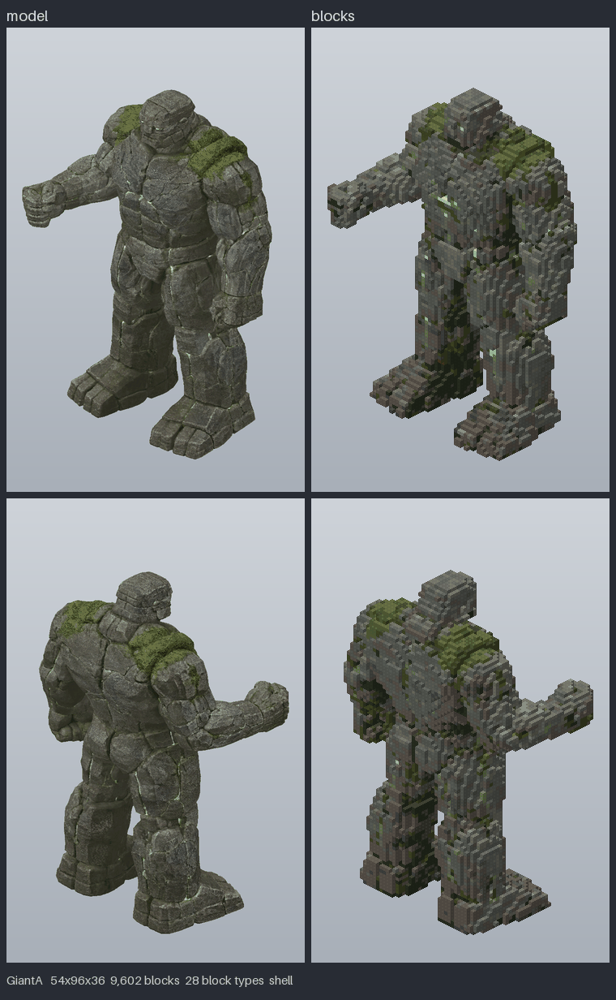
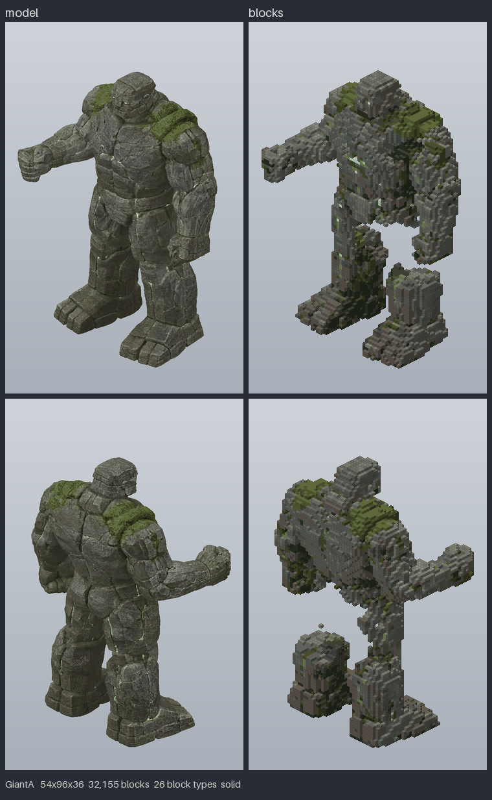

# Walkthrough: a Tripo model in blocks

This is one real run, start to finish, with a model made in Tripo. The model file isn't in this repo, but any textured
GLB works the same way.

## 1. The model

The stone giant was made in [Tripo Studio](https://studio.tripo3d.ai) from four views of the same figure (front, left, back
and right, image to 3D with texture) and downloaded as a GLB. It is one mesh of 19,585 triangles with one base-colour texture, Y-up and about 1 unit tall.
That is the kind of model this tool handles best, so nothing needs fixing first.

## 2. Convert it

```sh
model2mc GiantA.glb --height 96 --out giant.schem --preview giant.png
```

```
loaded GiantA.glb: 19,585 triangles in 1 part
54 x 96 x 36 (W x H x L), 9,602 blocks of 28 kinds
time: load 0.21s, voxelize 0.23s, match 0.14s, export 0.00s, preview 1.44s, total 2.03s
wrote giant.schem
wrote giant.png
Made with Tripo (sponsored): https://tripo.pxf.io/xJdOKy?p.invite_code=8615S1
```

That is 96 blocks tall, 9,602 blocks of 28 kinds, in about two seconds on a desktop CPU (Intel i7-12700K). Most of the
time goes on the preview. The default palette and shell mode were the best fit here. Limiting the palette to
`--palette stone,natural` gave a greyer giant with duller moss, so the defaults stayed.



*Stone giant made with Tripo. Left the model, right the blocks.*

## 3. A broken one

The same giant, filled solid and converted with three seeded cuts (see [damage.md](damage.md)):

```sh
model2mc GiantA.glb --height 96 --mode solid --damage-seed 11 \
  --damage cuts=3,size=0.12,ymin=0.35,ymax=0.9 --out giant-damaged.schem --preview giant-damaged.png
```

This gives 32,155 blocks of 26 kinds in 2.1 seconds. One cut takes the giant's left leg off at the knee. Solid mode
matters here: in shell mode a cut shows the hollow inside. The same seed and spec always give the same cuts.



*Stone giant made with Tripo, with `--damage-seed 11`.*

## 4. Into the game

Copy `giant.schem` into WorldEdit's `schematics` folder, then `//schem load giant` and `//paste`. The base centre lands
at your feet, facing south. See [Pasting it in](../README.md#pasting-it-in) for the vanilla structure route.

The preview images in `examples/` were saved as 256-colour PNGs to keep them small. The converter writes full colour.
